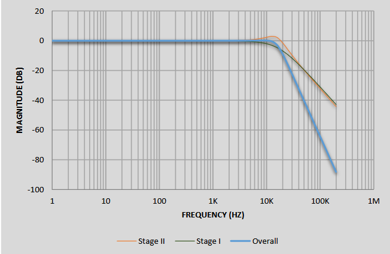
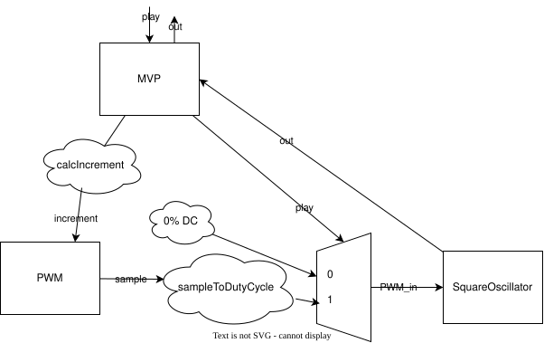

# Group 13 - Parameterizable Live Controlled Synthesizer
=======================
## Dependencies

#### JDK 11 or newer

We recommend using Java 11 or later LTS releases. While Chisel itself works with Java 8, our preferred build tool Mill requires Java 11. You can install the JDK as your operating system recommends, or use the prebuilt binaries from [Adoptium](https://adoptium.net/) (formerly AdoptOpenJDK).

#### SBT or mill

SBT is the most common build tool in the Scala community. You can download it [here](https://www.scala-sbt.org/download.html).
Mill is another Scala/Java build tool preferred by Chisel's developers.
This repository includes a bootstrap script `./mill` so that no installation is necessary.
You can read more about Mill on its website: https://mill-build.org.

#### Verilator

The test with `svsim` needs Verilator installed.
See Verilator installation instructions [here](https://verilator.org/guide/latest/install.html).


## Synthesizer configuration

The synthesizer reads [`synth.env`](synth.env) into `Env` before Chisel generates
hardware. Use this file to describe the note bank, voice types, and each voice's
ADSR settings. These are build-time settings: editing the file does not change
an FPGA that is already running.

### 1. Open the config file

Open a terminal in the repository root, the folder containing `build.sbt` and
`synth.env`. Edit `synth.env` in your text editor. The checked-in file contains:

```dotenv
# Four consecutive notes, beginning at C4.
AMOUNT_FREQ=4
ROOT_MIDI_NOTE=60

# One square-wave voice; envelope bypassed for the current MVP.
VOICE_COUNT=1
VOICE_0_TYPE=square
VOICE_0_ENVELOPE_ENABLED=false
VOICE_0_ATTACK_MS=10
VOICE_0_DECAY_MS=100
VOICE_0_SUSTAIN=0.7
VOICE_0_RELEASE_MS=200
```

Write one `KEY=VALUE` per line. Blank lines and comments starting with `#` on
their own line are allowed. Values may have matching single or double quotes.
Keys are case-sensitive and must not be repeated. Put comments on separate
lines; inline comments, `export`, and variable expansion are not supported.

### 2. Choose the note bank and voices

| Setting | Allowed values | Default when omitted |
| --- | --- | --- |
| `AMOUNT_FREQ` | Integer 1–16: number of consecutive playable notes / switch inputs. | `16` |
| `ROOT_MIDI_NOTE` | Integer 0–127: first MIDI note. `60` is C4; `69` is A4. | `69` |
| `VOICE_COUNT` | Integer 1–3: number of waveform voices. | `1` |
| `VOICE_n_TYPE` | `square`, `sine`, `sawtooth`, or `triangle`. Values are case-insensitive. | `square` |
| `VOICE_n_ENVELOPE_ENABLED` | `true` to enable that voice's ADSR configuration; `false` to bypass it when integrated. | `false` |
| `VOICE_n_ATTACK_MS` | Nonnegative integer milliseconds from zero to peak amplitude. | `10` |
| `VOICE_n_DECAY_MS` | Nonnegative integer milliseconds from peak to sustain level. | `100` |
| `VOICE_n_SUSTAIN` | Decimal 0–1: held amplitude as a fraction of the peak. This is a level, not a duration. | `0.7` |
| `VOICE_n_RELEASE_MS` | Nonnegative integer milliseconds from the current amplitude to zero after note-off. | `200` |

Replace `n` with `0`, `1`, or `2`. For two voices, use `VOICE_COUNT=2` and
prefix their settings with `VOICE_0_` and `VOICE_1_`. Settings for an index outside
`VOICE_COUNT` are rejected. The number of voices is separate from the number of
playable notes. The highest note, must be at
most 127. Durations must fit a Scala `Int` (0–2147483647 milliseconds).

To describe a second voice with a different waveform and envelope, set
`VOICE_COUNT=2` and add:

```dotenv
VOICE_1_TYPE=sawtooth
VOICE_1_ENVELOPE_ENABLED=true
VOICE_1_ATTACK_MS=50
VOICE_1_DECAY_MS=250
VOICE_1_SUSTAIN=0.5
VOICE_1_RELEASE_MS=500
```

Each voice has independent settings. To give voices identical envelopes, repeat
the same ADSR values under their respective prefixes. Disabled envelopes retain
their settings as configuration data. A complete example is in
[`config/examples/three-voices.env`](config/examples/three-voices.env).

The current MVP hardware consumes the note-bank settings and supports one square
voice without an envelope. The loader accepts the complete voice format, but
hardware generation rejects unsupported voice selections until the oscillator
and ADSR teams integrate their modules. You can inspect multi-voice configurations
now, but cannot generate working multi-voice/ADSR hardware from this MVP yet.

### 3. Check the loaded values

Save the file, then run from the repository root:

```powershell
sbt "runMain ShowSynthConfig"
```

With the checked-in configuration, the output includes:

```text
AMOUNT_FREQ=4
ROOT_MIDI_NOTE=60
MIDI note range: 60 to 63
VOICE_COUNT=1
VOICE_0_TYPE=square
VOICE_0_ENVELOPE_ENABLED=false
```

It also prints all four ADSR parameters. This command only reads and displays the
configuration; it does not generate hardware. Missing keys use the defaults in
the table. A missing file or invalid setting causes an error instead of silently
ignoring it.

### 4. Use a different config file

Set `SYNTH_CONFIG` before starting sbt. For example, inspect the supplied
three-voice example in PowerShell:

```powershell
$env:SYNTH_CONFIG = "config/examples/three-voices.env"
sbt "runMain ShowSynthConfig"
Remove-Item Env:SYNTH_CONFIG
```

You can replace the path with your own config file, including an absolute path.
Removing `SYNTH_CONFIG` returns subsequent runs to `synth.env`, unless the JVM
property `synth.config` is set. Path precedence is `synth.config`, then
`SYNTH_CONFIG`, then `synth.env` in the working directory. In an IDE, set that
working directory to the repository root or select an absolute file path.

### 5. Run the configuration tests

```powershell
sbt "testOnly SynthConfigSpec SynthConfigHardwareSpec"
```

These tests check parsing, valid/invalid settings, per-voice data, and the current
MVP's note-bank behavior. Run the hardware test with an MVP-compatible config:
one square voice and `ENVELOPE_ENABLED=false`. Parser tests alone can be run with
`sbt "testOnly SynthConfigSpec"`. These do not test ADSR envelope hardware.

### 6. Generate hardware

With an MVP-compatible config selected, run:

```powershell
sbt "runMain Nexys4Gen"
```

This writes `generated/MVP_Octave.sv`; the board top module is `Nexys4Wrapper`.
Rebuild the Vivado design and program the FPGA to apply the new settings.
The supplied `xdc_files/Nexys4DDR_octave.xdc` describes 16 switches. If fewer
notes are generated, use matching constraints for only the generated input ports.
The config loader does not generate pin constraints.

If using an interactive sbt session, exit it and start a fresh session after
editing the file: `Env` is initialized once per JVM. Each standalone `sbt ...`
command above starts a fresh session.

### Troubleshooting

- **Config file not found:** run from the repository root or select the correct
  path with `SYNTH_CONFIG`.
- **Unsupported key or duplicate setting:** check the spelling, capitalization,
  and whether the key appears more than once.
- **Inactive voice:** increase `VOICE_COUNT` or remove settings for unused indices.
- **Invalid value:** use whole milliseconds, sustain from 0 to 1, valid MIDI
  notes, and one of the four supported waveform names.
- **MVP integration error:** use one square voice with its envelope disabled for
  hardware generation. Other selections can be parsed and inspected while the
  group completes the oscillator and envelope integration.

See [the complete configuration format](docs/configuration.md) for all fields,
defaults, and the Scala interface for the oscillator and envelope teams.

## File Structure

`.xdc` files are saved in `xdc_files/`. In case inputs change between branches etc. we want to keep them fairly tied to a feature.

The generated system verilog files are in `generated/`

The rest is typical chisel file structure

>  ```
> my-project/
> ├── build.sbt
> ├── project/
> │   └── build.properties
> ├── src/
> │   ├── main/
> │   │   └── scala/
> │   │       └── mypackage/      # all lowercase, no underscores
> │   │           ├── MyTop.scala # UpperCamelCase, matches top-level class
> │   │           ├── MyModule.scala
> │   │           └── MyBundle.scala
> │   └── test/
> │       └── scala/
> │           └── mypackage/          # mirrors main package structure
> │               ├── MyTopSpec.scala
> │               └── MyModuleSpec.scala
> ├── .gitignore
> └── README.md   
> ```

## Project Description
This project will use chisel generators, combined with a spreadsheet of required components, to generate a custom hardware synthesizer as defined in the spreadsheet. The synthesizer will have a maximum of 3 voices, which the user can define as sine, square, sawtooth, or triangle. The user can also define an envelope (Attack, Decay, Sustain, and Release parameters) for each voice.

The synthesizer can be connected to a MIDI keyboard, and played live, or it can be connected to a computer and play a sequence of pre-programmed notes.

## Glossary

| Term                   | shorthand | Description                                                                                                                                                    |
| ---------------------- | --------- | -------------------------------------------------------------------------------------------------------------------------------------------------------------- |
| Amplitude              | amp       | Peak magnitude of a wave; perceived as loudness                                                                                                                |
| Sample rate            | fs        | Samples produced per second (Hz)                                                                                                                               |
| Sample                 |           | Signed int value of the audio wave at one point in time; one per sample period                                                                                 |
| Phase                  |           | Current position within one wave period, 0 to 2π (or 0 to max of the phase counter)                                                                            |
| Phase accumulator      |           | Counter incremented by the tuning word each sample; its value is the phase                                                                                     |
| Tuning word            |           | Phase increment per sample; sets output frequency: $f = inc \cdot fs / 2^N (N = acc.width)$                                                                    |
| Nyquist frequency      | Nyquist   | fs / 2; highest frequency representable without aliasing                                                                                                       |
| Aliasing               |           | Content above Nyquist folding back as false lower frequencies                                                                                                  |
| Pulse-Width-Modulation | pwm       | 1-bit output whose average (duty cycle) encodes an analog level                                                                                                |
| Duty cycle             |           | Fraction of a PWM period the output is high                                                                                                                    |
| Low-pass filter        | LPF       | Attenuates frequencies above a cutoff; turns PWM into an analog waveform                                                                                       |
| pwm frequency          | pwm       | The frequency of off and on-duty cycle. `counter_size` in PWM. Should be 10 times the desired audio frequency (sample rate) $`\text{counter\_size} \propto sampleWid`$ |
| Oscillator             | osc       | Generates a periodic waveform (sine, square, sawtooth, triangle) at a given frequency                                                                          |
| Voice                  |           | One independently playable sound: oscillator + envelope                                                                                                        |
| Envelope               | ADSR      | Amplitude shape over a note's life: Attack, Decay, Sustain, Release                                                                                            |
| Attack                 | A         | Time to rise from 0 to peak after note-on                                                                                                                      |
| Decay                  | D         | Time to fall from peak to sustain level                                                                                                                        |
| Sustain                | S         | Level (not time) held while the note is on                                                                                                                     |
| Release                | R         | Time to fall from sustain to 0 after note-off                                                                                                                  |
| MIDI                   |           | Serial protocol (31.25 kbaud) for note-on/off, pitch and velocity messages                                                                                     |


## Nexys DDR4 Audio Output Specs

-  Pin A11 is connected to AUD_PWM, which is  the input to an analog low-pass filter$[^1]$


> [!CAUTION]
> Input should be low impedance `Z` for logic `1`. For logic `0` output should not be driven.

generating a signal is as simple as connecting the output to a PWM generator and setting the duty cycle of the PWM to what frequency we want to produce. sample verilog code included below

```verilog
module pwm_module( 
input clk,
input [10:0] PWM_in, 
output reg PWM_out
);

reg [10:0]new_pwm=0;
reg [10:0] PWM_ramp=0; 
always @(posedge clk) 
begin
    if (PWM_ramp==0)new_pwm<=PWM_in;
      PWM_ramp <= PWM_ramp + 1'b1;
      PWM_out<=(new_pwm>PWM_ramp);
end

endmodule
```

- no hard specs on what frequencies need to be met by hardware, the only caveat is that the datasheet recommends that our PWM frequency be at least one order of magnitude higher than anything we want the audio output to produce. using a system clock of 100MHz to drive the PWM should meet this constraint with plenty of room. 


## Interfaces

### PWM
```
PWM(counter_size):
  width = log2Ceil(counter_size)
  io = (
    PWM_out = Output(Bool())
    PWM_in = Input(UInt(width.W))
  )
```
### Oscillator

```
SquareOscillator(
    amp: Int, 
    sampleWid: Int, 
    phaseWid: Int 
):
    io = (
        increment = Input(UInt(phaseWid.W)) 
        sample=Output(SInt(sampleWid.W)) 
    )
    
```

### MVP

```
MVP(
    amp: Int = 256,
    sampleWid: Int = 8,
    phaseWid: Int = 16,
    frequency: Int = 440, // Frequency to play square wave in Hz,
    sampleRate: Int = 48_000
):
  io = (
    play = Input(Bool()) // Whether to play sound or not
    out = Output(Bool()) // Linked to AUD_PWM
  )
```

### Connection graph



## Sources

[^1]: https://digilent.com/reference/programmable-logic/nexys-4-ddr/reference-manual

[^2]: https://digilent.com/reference/programmable-logic/nexys-4-ddr/reference-manual#pulse-width_modulation

[^midi]: https://www.songstuff.com/recording/article/midi-message-format/
