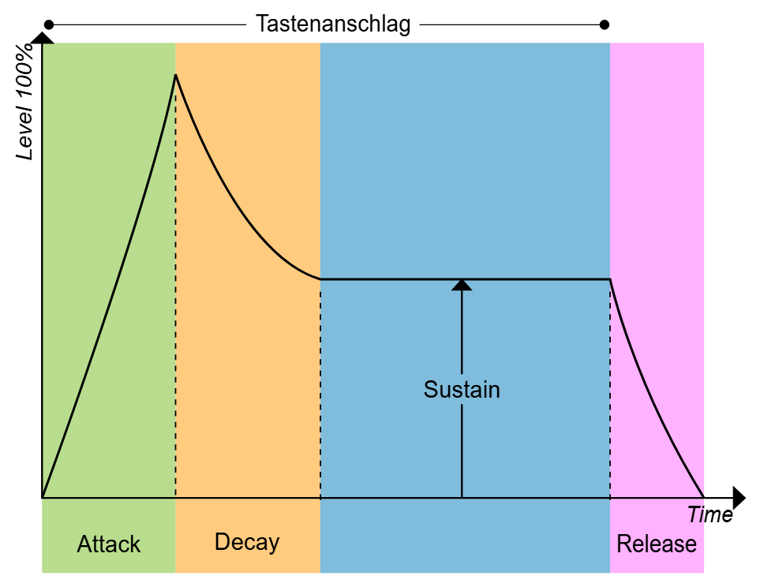

# The envelope: how it works and how to set it

An oscillator on its own plays at full volume the instant a key goes down and
stops the instant it comes up. The **envelope** is a volume curve applied to each
note that shapes how it starts, how it settles while the key is held, and how it
ends. The oscillator keeps producing the same wave but the envelope decides how
loud it is at each moment.


## The four settings

The envelope is called **ADSR** after its four settings:

| Stage | Config key | Unit | What it does |
| --- | --- | --- | --- |
| **A**ttack | `ATTACK_MS` | milliseconds | Time for the volume to rise from silence to full after the key goes down |
| **D**ecay | `DECAY_MS` | milliseconds | Time to fall from full volume to the sustain level |
| **S**ustain | `SUSTAIN` | level, 0 to 1 | The volume held for as long as the key stays down |
| **R**elease | `RELEASE_MS` | milliseconds | Time to fade to silence after the key comes up, from wherever the volume was |

Attack, decay and release are **times** and Sustain is a **level**.
For example "Sustain 0.7" means "hold at 70% of full volume".

- **Sustain 1.0** means there is no dip after the attack, and the decay has no
  effect. **Sustain 0** means the note dies away by itself after the decay, even
  if the key is still held.

## Setting it in the project

The settings live in [`synth.env`](../synth.env), one block per voice
(`VOICE_0_`, `VOICE_1_`, `VOICE_2_`). See [configuration.md](configuration.md)
for the full file format.

```dotenv
VOICE_COUNT=1
VOICE_0_TYPE=square
VOICE_0_ENVELOPE_ENABLED=true
VOICE_0_ATTACK_MS=10
VOICE_0_DECAY_MS=100
VOICE_0_SUSTAIN=0.7
VOICE_0_RELEASE_MS=200
```

1. Edit the values in `synth.env`.
2. Check what the project will read: `sbt "runMain ShowSynthConfig"`.
3. Regenerate the hardware: `sbt "runMain Nexys4Gen"`, then rebuild and program
   the FPGA.

Rules for the values:

- Times are whole, non-negative milliseconds. Sustain is a decimal from 0 to 1.
- `ENVELOPE_ENABLED=false` bypasses the envelope. The voice is then at full
  volume while the key is held and silent otherwise. The ADSR values are kept, so
  you can switch it on later without retyping them.
- The envelope updates 1000 times per second, so times are accurate to about
  1 ms. The longest possible stage is about 65 seconds.

## The metrics

The module `ADSREnvelope` is a small state machine (idle, attack, decay, sustain,
release) with a 16-bit level register that moves up or down by a fixed step on
each 1 kHz tick.

| Signal | Direction | Meaning |
| --- | --- | --- |
| `gate` | in | High while the key is held |
| `level` | out | The current volume, 0 up to full scale |
| `active` | out | High from key-down until the release has finished |

- Releasing the key in any stage starts the release from the current level, with
  no jump. Pressing again during a release restarts the attack from the current
  level.
- `Synth` multiplies the oscillator sample by `level`, so a level of 0 is silence
  and full scale is the oscillator's full amplitude.
- Each note slot has its own envelope. A released note keeps its pitch and its
  slot, and the PWM output stays on, until `active` drops, so the release is not
  cut off.