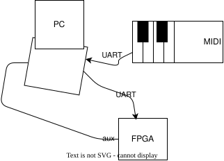
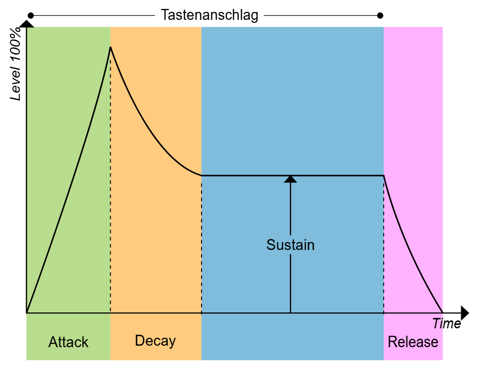
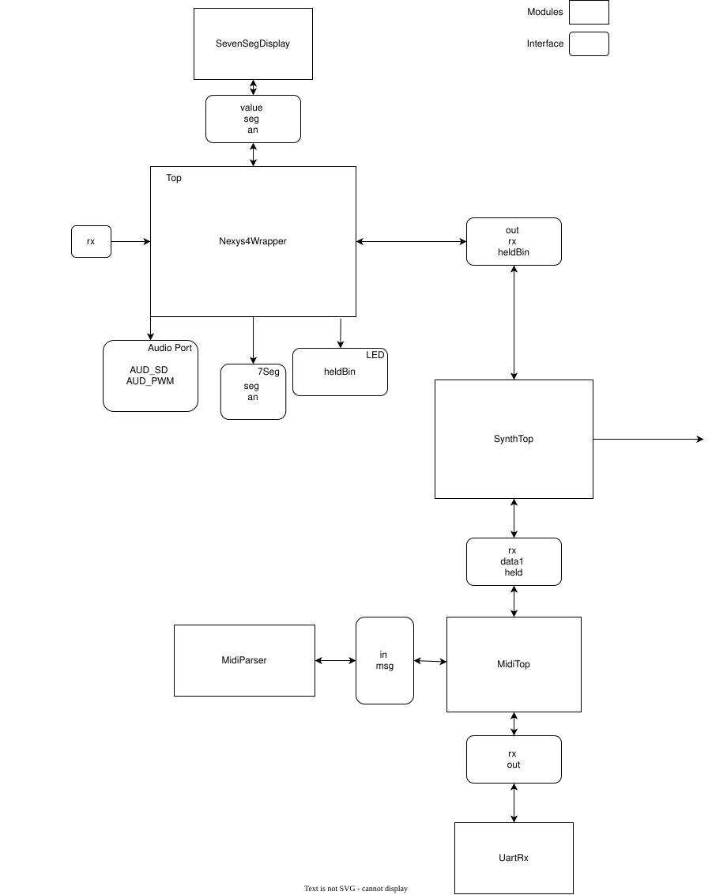
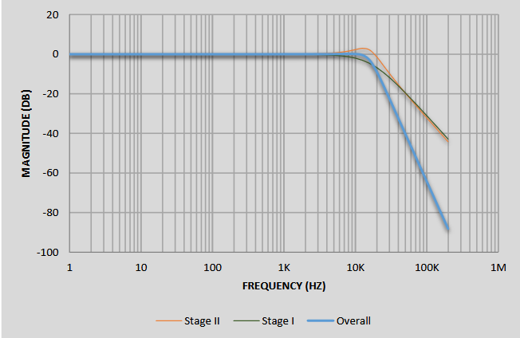
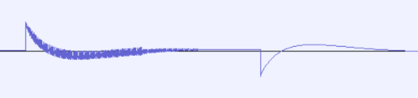

# Group 12 - Parameterizable Live Controlled Synthesizer
> we are group 13 on learn

## Contributors

- Lubaba Fairuz (s235484)
- Nafissatou Wassa (s235477)
- Zyra Martin (s241487)
- Rose Timlin (s260105)
- Lasse Nørbjerg (253860)


## Description
This project will use chisel generators, combined with a human-writeable config file
- to generate a customizable synthesizer on an FPGA board

The synthesizer will have a maximum of 3 voices. Which can be:
1. sine
2. square
3. sawtooth
4. triangle
  
The user can also define an envelope (Attack, Decay, Sustain, and Release parameters) for each voice.

The synthesizer can receive MIDI notes through UART.

It can be played live with a MIDI controller by connecting the FPGA to a computer that is forwarding the MIDI notes to the FPGA.

## Setup



0. RTL code has been generated from a specific config file and synthesized onto the FPGA
1. Midi input is going into the PC through UART
   - It is possible to send PC keystrokes as Midi instead
2. PC is forwarding Midi to the FPGA through UART
3. FPGA is reading Midi and producing audio through its audio port
4. Aux cable goes back into PC as line-in
    - Aux cable can also be plugged into speakers
    - Playback has to be enabled for line-in to play through speakers


## Table of contents
=======================

- [Group 12 - Parameterizable Live Controlled Synthesizer](#group-12---parameterizable-live-controlled-synthesizer)
  - [Contributors](#contributors)
  - [Description](#description)
  - [Setup](#setup)
  - [Table of contents](#table-of-contents)
  - [Glossary](#glossary)
  - [Dependencies](#dependencies)
    - [JDK 11 or newer](#jdk-11-or-newer)
    - [SBT](#sbt)
    - [Verilator](#verilator)
    - [Synthesis tool](#synthesis-tool)
    - [Python](#python)
    - [Venv](#venv)
  - [Requirements](#requirements)
  - [File Structure](#file-structure)
- [Using the Synthesizer](#using-the-synthesizer)
  - [Configuration](#configuration)
- [Implementation](#implementation)
  - [Schematic](#schematic)
  - [Nexys DDR4 Audio Output Specs](#nexys-ddr4-audio-output-specs)
  - [Testing](#testing)
- [Discussion](#discussion)
  - [Future prospects](#future-prospects)
    - [Desired Fixes](#desired-fixes)
    - [Desired Features](#desired-features)
  - [AI Acknowledgements](#ai-acknowledgements)
- [Sources](#sources)

=======================

## Glossary

| Term            | Alias     | Description                                                                                                                               |
| --------------- | --------- | ----------------------------------------------------------------------------------------------------------------------------------------- |
| Config file     | .env file | A file configuring the synthesizer. Voice types and Envelope                                                                              |
| MIDI            | midi      | Serial protocol. Here used for sending on/off signals for specific notes. Protocol also has 16 channels and velocity which is unused here |
| Midi Controller | Keyboard  | A device capable of sending Midi signals through a cable. Usually a Piano or Drumpad layout                                               |
| ADSR Envelope   | Envelope  | Describing volume over time. Measured in ms. Attack, Decay, Sustain, Release. [^envelopeImg]           |
| Synthesizer     | synth     | Describing the whole project running on the FPGA                                                                                          |
|                 |           |                                                                                                                                           |


## Dependencies

For more info see https://github.com/schoeberl/chisel-lab/blob/master/Setup.md

### JDK 11 or newer

We recommend using Java 11 or later LTS releases. [Adoptium](https://adoptium.net/) (formerly AdoptOpenJDK).

### SBT

You can download it [here](https://www.scala-sbt.org/download.html).

### Verilator

The test with `svsim` needs Verilator installed.
See Verilator installation instructions [here](https://verilator.org/guide/latest/install.html).

### Synthesis tool
We used [Vivado 2025-1](https://www.amd.com/en/support/downloads/adaptive-socs-and-fpgas/development-tools/2025-1.html)

### Python

[python download](https://www.python.org/downloads/)
Python 3.11 has been used for this project.

### Venv

```
python -m venv .venv
```

**Activate Venv Powershell**
```ps1
.\.venv\Scripts\activate.ps1
```
**Activate Venv Unix**
```sh
source ./.venv/bin/activate
```

**Install requirement**
Assuming venv activated and in root of project
```sh
pip install -r ./scripts/requirements.txt
```

## Requirements

- [Dependencies](#dependencies) have been setup
- [Nexys4 DDR FPGA board](https://digilent.com/reference/programmable-logic/nexys-4-ddr/reference-manual)
- Midi Keyboard (optional)
- Aux cable

## File Structure

`.xdc` files are saved in `xdc_files/`. In case inputs change between branches etc. we want to keep them fairly tied to a feature.

The generated system verilog files are in `generated/`

The rest is typical chisel file structure

>  ```
> my-project/
> ├── build.sbt
> ├── project/
> │   └── build.properties
> ├── src/
> │   ├── main/
> │   │   └── scala/
> │   │       └── mypackage/      # all lowercase, no underscores
> │   │           ├── MyTop.scala # UpperCamelCase, matches top-level class
> │   │           ├── MyModule.scala
> │   │           └── MyBundle.scala
> │   └── test/
> │       └── scala/
> │           └── mypackage/          # mirrors main package structure
> │               ├── MyTopSpec.scala
> │               └── MyModuleSpec.scala
> ├── .gitignore
> └── README.md   
> ```

# Using the Synthesizer

## Configuration

<!-- LUBABA PUT Synthesizer configuration HERE -->

# Implementation

## Schematic



## Nexys DDR4 Audio Output Specs

-  Pin A11 is connected to AUD_PWM, which is the input to an analog low-pass filter[^nexys4Pwm]

[^nexys4Pwm]


> [!CAUTION]
> Input should be low impedance `Z` for logic `1`. For logic `0` output should not be driven.
> [^nexys4Pwm]

> [!NOTE]
> `AUD_SD` must be connected to logic `1` for enabled audio.

> [!WARNING]
> Precautions ignored in the following example
> 
> i.e. we set AUD_PWM high and ignore AUD_SD

Generating a signal is simple
- Connect output to a PWM generator
  - setting duty cycle to what frequency we want to produce

Sample verilog code included below

```verilog
module pwm_module( 
input clk,
input [10:0] PWM_in, 
output reg PWM_out
);

reg [10:0]new_pwm=0;
reg [10:0] PWM_ramp=0; 
always @(posedge clk) 
begin
    if (PWM_ramp==0)new_pwm<=PWM_in;
      PWM_ramp <= PWM_ramp + 1'b1;
      PWM_out<=(new_pwm>PWM_ramp);
end

endmodule
```

- No hard specs on what frequencies need to be met by hardware
- Datasheet recommends[^nexys4Pwm]
  - PWM frequency at least one order of magnitude higher than produced audio
  - System clock in the MHz should meet this constraint with plenty of room


## Testing

# Discussion

## Future prospects

### Desired Fixes

- Some keys makes the speaker pop
  - 
  - Start and stop peaks can be seen
- Constant hum when connected
  - Probably because it is a closed circuit
    - pc->usb->fpga->aux->pc

### Desired Features

- Multi channel support
  - E.g.
    - different config values for different channels
    - Knobs working
- Velocity support
- Use without PC
  - Flash implementation onto FPGA
  - Have a battery
  - Connect MIDI Usb to PMOD
  - Built into its own little synth maybe?


## AI Acknowledgements
Copilot in VSCode was used intermittently to auto-complete code.


# Sources

[^nexys4Manual]: https://digilent.com/reference/programmable-logic/nexys-4-ddr/reference-manual
[^nexys4Pwm]: https://digilent.com/reference/programmable-logic/nexys-4-ddr/reference-manual#pulse-width_modulation
[^envelopeImg]: https://commons.wikimedia.org/wiki/File:ADSR_v2.svg
